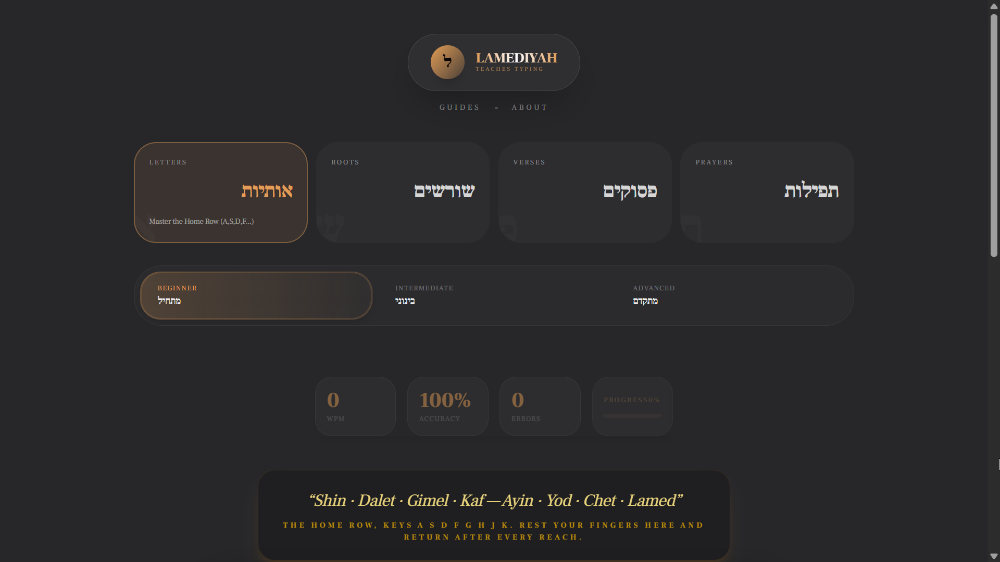

<div align="center">
  

  # LamediYah Teaches Typing

  **Learn Hebrew touch typing on the keyboard you already have.**
  <br>
  English Hand · Hebrew Soul

  **[lamediyah.app](https://lamediyah.app)** · [Guides](https://lamediyah.app/guides) · [About](https://lamediyah.app/about)

  <br>

  
</div>

---

## About

LamediYah is a free, open-source Hebrew touch typing trainer for English speakers, especially students of **Biblical Hebrew**. You practice on the standard Israeli Hebrew layout with an on-screen keyboard that shows both the English key and the Hebrew letter, so you don't need stickers or a special keyboard.

Instead of random drills, you type real Hebrew: letters, three-letter **roots**, **Tanakh verses** and **prayers**, each with its translation and meaning.

> LamediYah needs a physical keyboard. On phones and tablets it shows a notice with a link to open it on a computer.

## Features

- **Four categories:** Letters (אותיות) · Roots (שורשים) · Verses (פסוקים) · Prayers (תפילות)
- **Three levels:**
  - Beginner: home row ש ד ג כ ע י ח ל
  - Intermediate: top and bottom rows
  - Advanced: full alphabet and final letters ך ם ן ף ץ
- **On-screen keyboard:** every key shows its English and Hebrew letter, highlights the next key, and names the finger to use
- **Live stats:** words per minute, accuracy, errors and lesson progress
- **Step-by-step progress:** score 95% or better to unlock the next exercise
- **Wisdom:** every exercise shows its translation, with a **Deeper Meaning** view
- **Sound cues:** short sounds for keystrokes, errors and completed exercises
- **Guides:** [keyboard layout](https://lamediyah.app/guides/hebrew-keyboard-layout) · [typing Hebrew on Windows and Mac](https://lamediyah.app/guides/type-hebrew-on-windows-mac) · [typing Biblical Hebrew](https://lamediyah.app/guides/biblical-hebrew-typing) · [Hebrew numbers](https://lamediyah.app/guides/hebrew-numbers)

## Getting started

Requires **Node.js 20+** and **pnpm**.

```bash
git clone https://github.com/LG-LegitGit/l-typing-app.git
cd l-typing-app
pnpm install
pnpm dev
```

Then open http://localhost:3000.

| Script | What it does |
|---|---|
| `pnpm dev` | Start the dev server |
| `pnpm build` | Production build |
| `pnpm start` | Serve the production build |
| `pnpm lint` | Run ESLint |
| `pnpm check:wisdom` | Check every exercise has a translation (Node 22.6+) |

### Environment variables

Optional. Copy `.env.example` to `.env.local`. Everything works without it except the contact form on `/about`, which then shows a "being set up" message.

| Variable | Used for |
|---|---|
| `NEXT_PUBLIC_WEB3FORMS_ACCESS_KEY` | Contact form via [Web3Forms](https://web3forms.com) |

## Tech stack

Next.js 16 (App Router) · TypeScript · Tailwind CSS 4 · shadcn/ui (Radix) · Zustand · Framer Motion · Frank Ruhl Libre and Geist fonts · hosted on Vercel

## Project structure

```
app/
├── page.tsx              # the typing app
├── layout.tsx            # metadata, Open Graph, JSON-LD
├── (content)/            # about and guides pages
└── robots.ts, sitemap.ts, manifest.ts
components/
├── core/                 # TypingEngine, WordDisplay, VirtualKeyboard, LessonSelector,
│                         # LiveStats, StatsBar, SoundEngine, WelcomeRitual
├── site/                 # ContactForm, GuideParts, MobileNotice
└── ui/                   # shadcn/ui primitives
lib/
├── data/                 # exercises, wisdom, alphabet, keyboard maps, phonetics
├── utils/stats.ts        # WPM and accuracy math
└── site.ts               # site URL, SEO values, guides list
store/useTypingStore.ts   # Zustand store: lesson, progress, stats
public/                   # images, sounds, Open Graph image
scripts/check-wisdom.mjs  # finds exercises missing a translation
```

### Adding exercises

1. Add the text to `lib/data/exercises.ts`, under its category and level. Exercises play in the order listed.
2. Add a matching entry to `lib/data/wisdom.ts`, keyed by the exact exercise text.
3. Run `pnpm check:wisdom` to confirm nothing is missing.

## Roadmap

- [ ] Niqqud (vowel point) lessons
- [ ] Custom lesson creator
- [ ] Progress export (JSON/CSV)
- [ ] Offline mode (PWA)

## Contributing

Bug fixes, new exercises, corrections to Hebrew text or translations, and accessibility improvements are all welcome.

1. Fork the repo and create a branch, for example `feat/your-change`.
2. Make your change, then run `pnpm build`, `pnpm lint` and `pnpm check:wisdom`.
3. Open a pull request against `main`. Include a screenshot for UI changes.

Found a mistake in a verse, root or translation? Open an issue with the reference (for example, Genesis 1:1) and the correction.

## License

Code: [MIT](./LICENSE) © 2026 LamediYah.

The name "LamediYah", the ל (lamed) logo and related branding are not covered by the MIT License. You're welcome to fork and build on the code, but please give your version its own name and logo and don't present it as the official LamediYah app.

The Biblical and liturgical Hebrew texts in the exercises are in the public domain.

---

<div align="center">
  <sub>English Hand · Hebrew Soul · <a href="https://lamediyah.com">lamediyah.com</a></sub>
</div>
