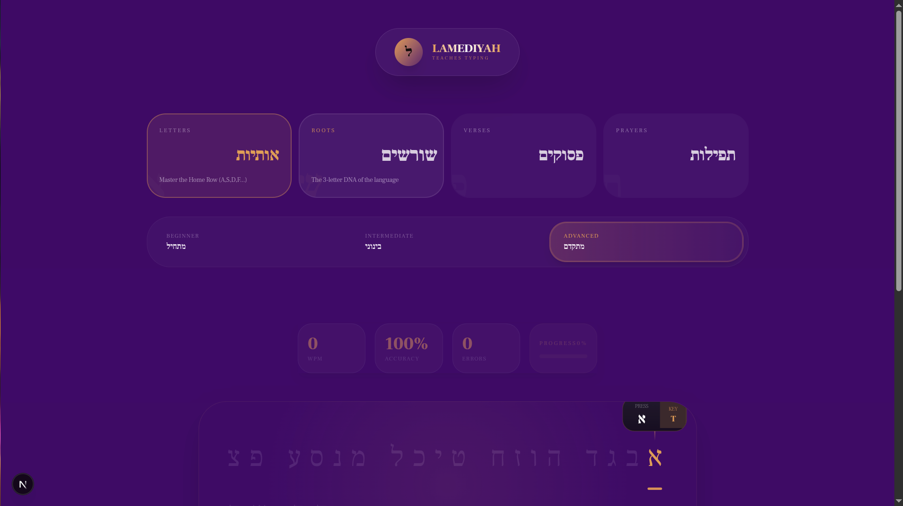
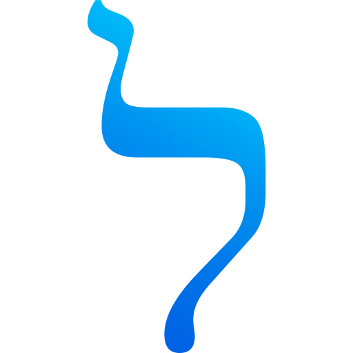

## 🏛️ **LamediYah Teaches Typing (ל)**

<div align="center">
  
</div>

**Master the Sacred Letters through Touch Typing Ritual.** English Hand -  Hebrew Soul.

***

## 🧘 **The Sacred Vision**

LamediYah is a **minimalist typing temple** designed to teach Hebrew through **Lucid Typing**—a flow state where every keystroke becomes meditation. From the "Welcome Ritual" to the "Golden Cockpit," every pixel serves the practice.

```
תורה STUDY → Black parchment + gold letters
תפילה PRAYER → Zero distraction
לימוד LEARNING → Perfect focus
```

## ✨ **Core Rituals**

- **🏺 Dual Type Hints** - English key + Hebrew letter (multi-line safe)
- **⚡ Sacred Altar** - Zero-scroll viewport, bulletproof spacebar protection
- **⌨️ Golden Cockpit** - Philosophy wings + VirtualKeyboard + signature
- **🕯️ Wisdom Modal** - Tanakh verses, prayers, roots with meaning
- **📊 LiveStats** - Real-time WPM, accuracy celebration (95%+ = הושלם)
- **🎵 SoundEngine** - Tactile audio feedback
- **🧘 Focus Lockdown** - No spacebar scrolling, instant blur handlers

## 🗝️ **The Sacred Flow**

```
SETTINGS SHRINE      → Letters/Roots/Verses/Prayers + מתחיל/בינוני/מתקדם
שדגכעיחל            → Type with [SPACE ש] dual hints
Lessons COLLAPSE     → Altar center stage
🕯 REVEAL WISDOM     → "בראשית ברא אלהים" → "In the beginning..."
CONTINUE • המשך      → Next sacred exercise
```

## 🛠 **Tech Temple**

```
Framework:  Next.js 16.1.4 (App Router) + TypeScript 5
Styling:    Tailwind CSS 4 + cn() + Headless UI (Radix)
State:      Zustand 5 (fully typed CategoryId/DifficultyId)
Animation:  Framer Motion 12 + Tailwind animate-in
Audio:      Web Audio API (SoundEngine)
Fonts:      Frank Ruhl Libre (Hebrew) + Geist Mono (keys)
Deployment: Vercel (h-screen viewport lock)
```

## 📂 **Temple Architecture**

```
app/page.tsx (h-screen no-scroll lock)
├── TypingEngine (global key capture)
├── SoundEngine (audio immersion)
├── Header (shrink-0 - fades when typing)
├── LessonSelector (Shrine - max-h-[500px] collapse)
├── Sacred Altar (flex-1)
│   ├── LiveStats (scale-110 when typing)
│   ├── WordDisplay (dual hints + wisdom modal)
│   └── Breadcrumb (amber-500)
└── Golden Cockpit (h-[300px] shrink-0)
    ├── English Hand • Hebrew Soul (xl wings)
    ├── VirtualKeyboard (scale-95 origin-bottom)
    └── LamediYah Signature (↗ lamediyah.com)
```

## 🎨 **Sacred Palette**

```
Background: Deep Space #0a0514 (focus perfected)
Primary:    Sacred Purple (var(--primary))
Accents:    Golden Amber (amber-500 glow)
Text:       White on black = Maximal contrast
Glows:      shadow-[0_0_30px_rgba(var(--primary-rgb),0.2)]
```

## 🚀 **Quick Start**

```bash
pnpm install
pnpm dev          # http://localhost:3000
pnpm build        # Production build
pnpm preview      # Preview production
```

## 📱 **Responsive Perfection**

```
xl (1400px+): Full cockpit wings visible
lg:           Keyboard scale-95
md:           Compact shrine
Mobile:       Keyboard-only cockpit, touch-optimized hints
```

## 🔮 **Future Rituals**

```markdown
- [ ] Niqqud (vowel points) lessons
- [ ] Custom lesson creator
- [ ] Progress export (JSON/CSV)
- [ ] PWA offline mode
- [ ] macOS/iOS viewport fixes
```

## 🙏 **Contributing**

1. Fork → `feat/dual-hints` branch
2. `pnpm install`
3. Sacred commits: `feat: hand-soul type hints`
4. Test: `pnpm dev` (no scrollbars!)
5. PR with screenshot → `main`

## 📄 **License**

[MIT](./LICENSE) © LamediYah

***

<div align="center">
  
  <br><br>
  <span class="text-xs opacity-50">English Hand -  Hebrew Soul</span>
</div>
```

